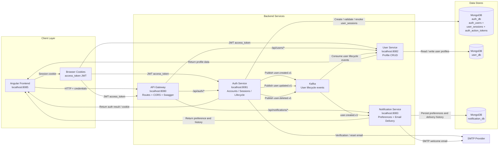
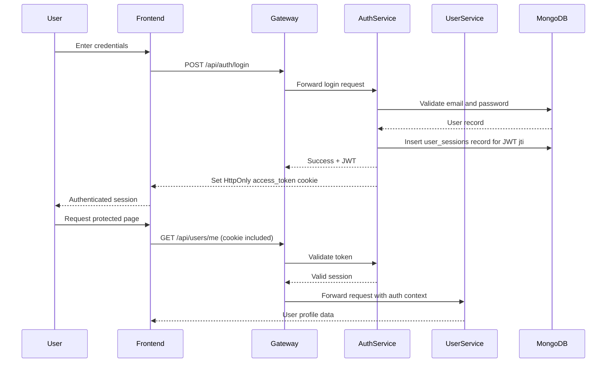
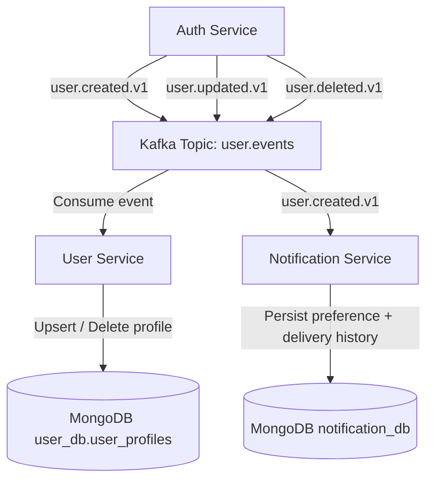

# Project Architecture

This document describes the current high-level architecture and runtime flow for the application.

## High-level architecture

## Request and authentication flow

## Event-driven synchronization flow

## Components

### API Gateway

- Routes requests to the auth, user, and notification services
- Centralizes Swagger and OpenAPI docs
- Handles CORS and credentials-aware browser traffic
- Forwards cookie-based authentication context to downstream services
- Uses a shared HTTP client with a 10-second timeout for upstream health and proxy calls, propagating request cancellation and deadlines

### Auth Service

- Handles registration, login, logout, and refresh
- Creates new accounts as unverified, sends verification links, and rejects login until email verification
- Issues single-use email-verification and password-reset tokens; stores only token hashes and expires them using MongoDB TTL
- Supports password reset/change, email re-verification, self-service account deletion, and admin account controls
- Validates credentials and account status against MongoDB
- Creates JWTs backed by revocable `user_sessions` records
- Validates session activity and revokes sessions on logout, refresh, password reset, email or role change, suspension, and account deletion
- Emits user lifecycle events to Kafka
- Sends verification and password-reset mail through the configured SMTP provider

### User Service

- Owns user profile state in `user_db`
- Consumes Kafka events to keep profiles synchronized
- Checks the synchronized verification/account status and active auth session on protected requests
- Enforces that users only access their own profile data

### Notification Service

- Stores notification preferences and delivery history
- Consumes `user.created.v1` and sends a welcome email when enabled
- Records failed or successful delivery attempts
- Uses optional SMTP configuration and degrades gracefully when email is not configured

## Data model

- `auth_db.auth_users`: authentication records
- `auth_db.user_sessions`: one revocable session record per issued cookie; stores session metadata, not the JWT
- `auth_db.auth_action_tokens`: hashed, single-use verification and password-reset tokens with expiration
- `user_db.user_profiles`: synced profile data
- `notification_db.notification_preferences`: per-user email preference
- `notification_db.notification_records`: delivery history and outcomes

## Operational notes

- Browser sessions use HttpOnly cookies; no token is stored in localStorage. Each cookie maps to an active `auth_db.user_sessions` record until logout, refresh, a security-sensitive account change, or expiration.
- Configure `SMTP_HOST`, `SMTP_PORT`, `SMTP_USERNAME`, `SMTP_PASSWORD`, and `EMAIL_FROM` for account verification and password-reset emails; `FRONTEND_URL` defines the public origin used in email links.
- Admin role/status changes and account deletions are applied in Auth Service and propagated to user profiles through Kafka. User Service also checks active account/session state on protected requests.
- Kafka keeps the services loosely coupled and resilient to async propagation
- The gateway acts as the single public interface for client traffic
- The backend supports both local containerized runs and production deployment via Docker Compose and the `deploy.sh` helper

## Future changes

Proposed follow-up work. Items are prioritized; higher priority should land before infra/product expansions unless a release needs them sooner.

### P0 — Security and correctness

1. ~~**Auth-side account delete**~~ — ✅ Done: self-service deletion requires the current password, revokes sessions, deletes the auth account, and publishes `user.deleted.v1` to remove the synchronized profile. Admins can also delete customer accounts.
2. ~~**Production cookie / TLS settings**~~ — ✅ Done: `COOKIE_SECURE=true` and `COOKIE_SAME_SITE=None` are now the production defaults (compose, `.env`, `deploy.sh`). `NewCookieConfig` enforces `Secure=true` whenever `SameSite=None` (RFC 6265bis).

### P1 — Reliability and quality

1. **Kafka DLQ + bounded retries / backoff** — Failed consumers can redeliver forever or drop bad events; registration can succeed even when Kafka publish fails. Add dead-letter topics, retry limits, and durable reconciliation where needed.
2. **Integration and contract tests** — Unit tests exist for core packages; add end-to-end coverage for auth → Kafka → user/notification sync and API contracts.
3. **CI pipelines** — Makefile and git hooks exist locally; add CI (e.g. GitHub Actions) for format, lint, test, build, and image validation.
4. ~~**Wire frontend to user APIs**~~ — ✅ Done: the admin dashboard lists paginated users with edit/delete actions, profile details can be updated, and placeholder dashboard metrics have been removed.
5. ~~**Service-level rate limiting**~~ — ✅ Done: Auth, User, and Notification services enforce per-IP token-bucket limits (10 requests/second, burst of 20) on API routes for defense in depth.

### P1 — Observability

1. **Correlation / `trace_id` propagation** across API Gateway → Auth, User, and Notification services (logs and headers).
2. **OpenTelemetry** instrumentation for distributed traces and metrics.
3. **Prometheus + Grafana** for request latency, error rates, Kafka consumer lag, and notification delivery outcomes.

### P2 — Product and infrastructure

1. **Additional notification channels** — Extend beyond email (SMS, push, WhatsApp) with isolated provider adapters and failure/retry tests.
2. **Kubernetes / Helm** — Manifests or charts with environment-specific overlays (dev, test, prod) when scaling beyond Compose.
3. **Load balancing and service discovery** — Evaluate when running multiple replicas of each service.
4. **Circuit breakers** for synchronous gateway → service calls (alongside timeouts).

### P2 — Cleanup and documentation

1. ~~**Remove Kratos greeter / helloworld scaffold** from the API Gateway~~ — ✅ Done: removed the unused HTTP/gRPC greeter, generated proto code, and scaffold biz/data/service packages; the gateway now exposes only its HTTP health, Swagger, and proxy routes.
2. ~~**Refresh docs**~~ — Keep `README.md` / `backend/README.md` aligned with reality (notification service is implemented; gateway and service-level rate limiting and router modules are done).
3. ~~**Auth / user product gaps**~~ — ✅ Done: password change/reset, email verification, profile email re-verification, password-confirmed self-service account deletion, and admin role/status/deletion controls are available through the UI and backend.
4. ~~**User sessions collection**~~ — ✅ Done: `auth_db.user_sessions` records each issued cookie by JWT session ID, validates active sessions, revokes sessions on logout/refresh/account deletion, and expires old records through a MongoDB TTL index.

### Already in place (do not re-plan as greenfield)

- Cookie-based JWT sessions (HttpOnly `access_token`)
- Bcrypt password hashing on register/login (with lazy upgrade of legacy plaintext rows)
- Auth, User, Notification, and API Gateway microservices
- MongoDB per-service databases and Kafka user lifecycle sync
- Zap structured logging, Swagger/OpenAPI on the gateway
- Gateway rate limiting and dedicated router modules
- Per-IP token-bucket rate limiting in Auth, User, and Notification services
- Notification preferences + delivery history (email path)
- Local / prod / test Docker Compose and `deploy.sh`
- Local `make` lint / test / security tooling and unit tests for core packages
- Toast notifications for success and error messages in the frontend
